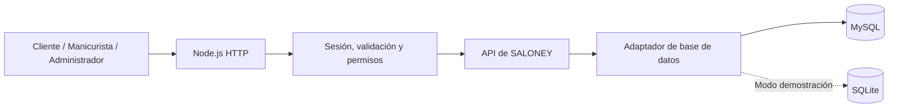
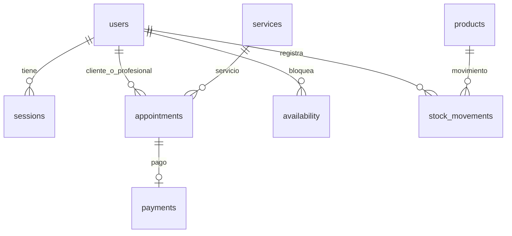

# Arquitectura de SALONEY

## Componentes

La interfaz utiliza HTML, CSS y módulos JavaScript sin un paso de compilación. Las vistas reutilizan funciones de navegación, formularios, tablas, calendario, tarjetas y gráficos. El estado se obtiene del servidor mediante una API JSON del mismo origen.

Node.js sirve los archivos estáticos y valida todas las operaciones de la API. `security.js` concentra validaciones y contraseñas. `db.js` presenta una interfaz común de consultas y escrituras para MySQL y SQLite. `seed.js` crea el catálogo y, cuando se habilita explícitamente en el entorno de demostración, los datos de ejemplo.

## Modelo de datos

Las reservas de invitadas tienen `client_id` nulo y conservan nombre y teléfono. Las profesionales son usuarios con rol `manicurista`. La cita conserva una copia de precio y duración: cambiar el catálogo no cambia retrospectivamente la reserva.

Los estados canónicos son `Pendiente`, `Confirmada`, `En proceso`, `Finalizada`, `Cancelada` y `Rechazada`. Los términos “Realizada” y “Completada” de los documentos se normalizaron como `Finalizada`.

## Disponibilidad y concurrencia

Los horarios se generan cada 30 minutos dentro del horario de apertura. Se comprueba que la duración completa quepa antes del cierre, que se respete la anticipación mínima y que no se superponga con citas activas ni bloqueos de la profesional. La validación se repite al guardar.

Las escrituras se ejecutan dentro de transacciones. MySQL bloquea la fila de `app_lock` con `SELECT ... FOR UPDATE`; SQLite usa `BEGIN IMMEDIATE`. La fila permite serializar reservas incluso si existen varios procesos Node conectados a MySQL. El proceso también encola consultas para impedir que una lectura observe escrituras incompletas de la conexión compartida. Esta estrategia prioriza integridad y sencillez para un salón; una operación de mayor escala debería usar un pool y bloqueos por profesional/fecha.

## Permisos

| Operación                        | Cliente                   | Manicurista                        | Administrador       |
| -------------------------------- | ------------------------- | ---------------------------------- | ------------------- |
| Reservar y elegir profesional    | Sí                        | No                                 | No                  |
| Consultar citas                  | Propias                   | Asignadas                          | Todas               |
| Modificar fecha/hora             | Propias, dentro del plazo | No                                 | Dentro del plazo    |
| Confirmar/rechazar               | No                        | Asignadas                          | Sí                  |
| Iniciar/finalizar                | No                        | Asignadas                          | Sí                  |
| Cancelar                         | Propias, dentro del plazo | No                                 | Sí                  |
| Reasignar profesional            | No                        | No                                 | No                  |
| Clientes e historial             | Solo el propio            | Clientes atendidas y citas propias | Todos               |
| Pagos                            | Consulta propia           | No                                 | Registro y consulta |
| Usuarios, servicios e inventario | No                        | Catálogo                           | Gestión             |
| Bloquear disponibilidad          | No                        | Propia                             | No                  |

## Decisiones de alcance

- Se conserva la regla explícitamente confirmada por el usuario: elección de manicurista por la cliente.
- El registro público siempre crea clientes, aunque una solicitud intente enviar otro rol.
- Los precios son COP enteros. Se registra un pago total por cita; no se implementan abonos, devoluciones ni cobros en línea.
- Los diseños y colores son preferencias; un adicional se acuerda con el salón. No se genera un sobreprecio sin una tarifa definida.
- La recuperación de acceso es administrativa; no se simulan correos enviados.
- Los recordatorios de correo/SMS y las reseñas/calificaciones de algunas referencias visuales no forman parte de esta implementación. Las notificaciones internas muestran las citas pendientes.
- La política inicial permite reservas todos los días dentro del horario configurado. Los días sin atención se bloquean desde la disponibilidad de cada profesional.
- La base local es persistente y la publicación externa queda fuera de la instalación local entregada.

## Operación

`iniciar.cmd` utiliza `scripts/start.js`, que detecta si el servidor ya está escuchando y, cuando corresponde a esta instalación, inicia MySQL 3307 sin ventana adicional. `scripts/backup.js` toma una copia consistente. `scripts/restore.js` valida el formato y solo inserta en una base vacía. `.env`, bases y respaldos se excluyen del control de versiones.
